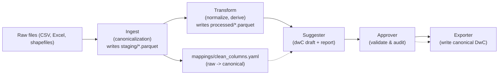

Architecture — dataflow and naming contract
==========================================

Mermaid diagram (pipeline flow)

Naming contract
---------------
- `ingest` is responsible for producing deterministic canonical column names when `cleaning.enabled: true`. The canonical mapping is recorded in `mappings/clean_columns.yaml` (raw -> canonical).
- All downstream steps (transform, suggester, approver, exporter) operate on the column names produced by `ingest`.
- Approved mappings must reference canonical column names (or raw names if `cleaning.enabled: false` — see dataset `dataset.yaml`).
- Reconciliation is conservative and never overwrites approved mappings automatically; it writes a candidate `*_reconciled.yaml` for human review.

Best practices
--------------
- Keep `cleaning.enabled: true` for deterministic outputs unless you have a strong reason to preserve raw header names.
- Use the suggester to produce a draft, review measurementType/unit choices, then run the approver to validate and create an auditable approved mapping.
- Add per-dataset `README.md` files documenting any source-specific quirks or required manual renames.
